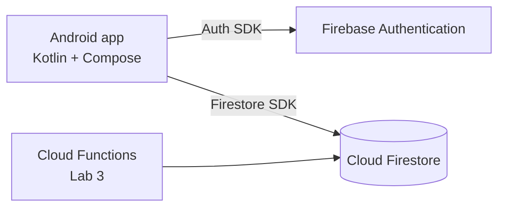

# Lost&Found

**Problem statement:**
Students lose items on campus and there is no centralized place to report or search for them, which means many items never return to their owners.

**Team:**
- Abel Cardoso (All roles: PO, Tech Lead, Developer, QA/DevOps)

**MVP Features:**
- [Sprint 1] User login and registration (Firebase Auth)
- [Sprint 1] Create a lost/found item ad
- [Sprint 1] See a list of all items
- [Sprint 1] View details and edit/delete own items
- [Later] Notify users when a similar item is found

## Data Model (Firestore)

### Collection: `items`

| Field | Type | Set by |
|---|---|---|
| id | String | Server (Firestore document ID) |
| ownerId | String | App (authenticated user ID) |
| title | String | User |
| description | String | User |
| location | String | User |
| categoryId | String | User (selected category) |
| categoryName | String | App (selected category name) |
| itemType | String | User |
| dateOccurred | Timestamp | User |
| createdAt | Timestamp | Server |
| updatedAt | Timestamp | Server |

### Collection: `categories`

| Field | Type | Set by |
|---|---|---|
| id | String | App (Firestore document ID) |
| name | String | App (reference data) |

**Notes:**
- `ownerId` is obtained from the authenticated Firebase session, never from user input.
- `createdAt` and `updatedAt` use Firestore server timestamps.
- `categoryId` references a document in the `categories` collection.
- The `categories` collection is reference data and is not edited by regular users.

## Architecture

## Tech Stack

| Component | Technology |
|---|---|
| Programming language | Kotlin |
| UI framework | Jetpack Compose |
| Authentication | Firebase Authentication |
| Cloud database | Cloud Firestore |
| Architecture | MVVM |
| Data layer | Repository Pattern |
| Asynchronous operations | Kotlin Coroutines and Flow |
| IDE | Android Studio |
| Version control | Git and GitHub |

## Definition of Done

A feature is considered done when:

- The feature works correctly in the Android application.
- User input is validated before data is saved.
- Invalid input does not create or update Firestore records.
- Firebase operations are handled through the repository layer.
- UI state is managed by ViewModels.
- Loading and error states are handled where applicable.
- Firestore security rules protect data access.
- Changes are committed and pushed to the GitHub repository.
- The application builds and runs without errors.
